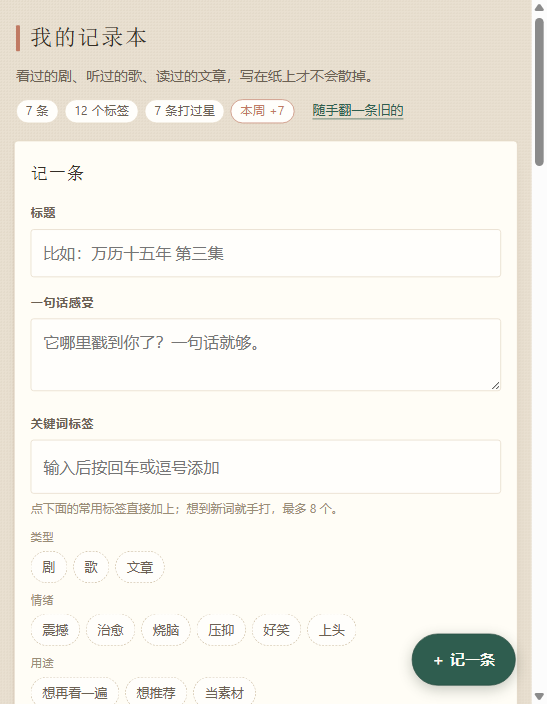
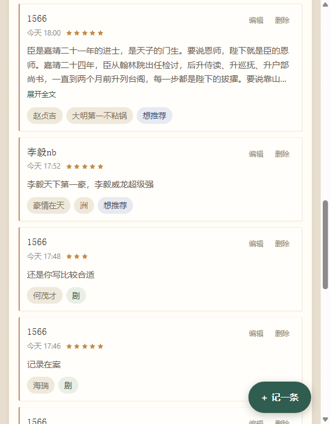
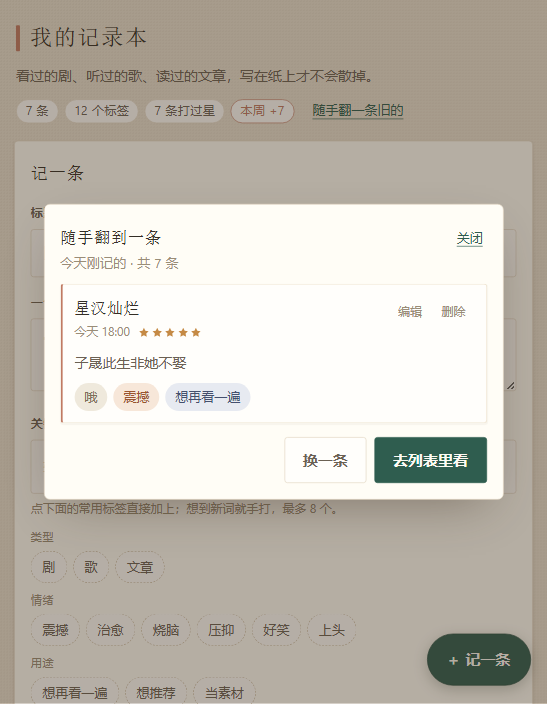

# 我的记录本 · My Notes

一个给「看完就忘」的人用的小记录本：看过的剧、听过的歌、读过的文章，30 秒记一条，以后能翻回来。

纯前端，**零依赖、零框架、零构建**，三个文件跑起来；断网也能记；可选把 GitHub 私有仓库当同步后端，实现多端共用一份数据。

> 默认纯本地模式：数据只存在你自己浏览器的 localStorage 里，不联网、不上传。

<p>
  
  
  
</p>

---

## 为什么做这个

我平时看历史剧、听歌、读文章，当时的感受记得很清楚，过两周就只剩「好像看过」。用笔记软件太重，用备忘录取又找不回来。

所以做了这个：**只留三样东西** —— 标题具体到哪一集、一句话说它戳到你哪里、几个关键词标签。就这样，30 秒能写完，事后按标签或时间能翻到。

## 功能

- 记录：标题 + 一句话感受 + 标签（类型/情绪/用途，点选或手打，最多 8 个）+ 星级 + 金句 + 来源链接
- 编辑、删除（删除会弹确认，并写一条"墓碑"防止别的设备把删掉的同步回来）
- 搜索（标题、感受、金句、来源、标签一起搜）、按标签筛选、按周/月/更早筛选
- 回顾：随机翻一条 7 天以前的旧记录，可「换一条」，也可跳到列表定位
- 长文案超过三行自动折叠，点「展开全文」
- 导出 / 导入 JSON 备份
- PWA：装到桌面/主屏幕，断网可用
- 三端云同步（可选）

## 技术选择（为什么不用框架）

| 决定 | 理由 |
| --- | --- |
| **原生 JS + 三个文件**（`index.html` / `style.css` / `main.js`） | 功能规模不大，引入框架带来的构建链、依赖审计、版本升级成本超过收益；也让这个项目可以"双击就能改" |
| **数据同步用 GitHub 仓库当后端** | 不想为一个人的记录去租服务器、维护数据库。GitHub 免费提供私有仓库 + 版本历史，正好当一份带审计的存储。代价是令牌必须放在前端（见下方风险） |
| **本地优先（local-first）** | 先写 `localStorage`，页面立刻有反应；后台再合并上云。断网照常记，联网自动补传 |
| **PWA 而不是小程序** | 自用的小工具不需要审核、不需要上架，装到主屏幕就有独立图标和离线能力 |
| **自己写预览服务器** | 只有 `node:http` + `node:fs`，用 `fs.watch` + SSE 做热刷新，不装任何 npm 包 |

## 快速开始

```powershell
cd 项目目录
node server.js          # 或 npm run dev
```

浏览器打开 <http://localhost:5180>，改代码保存后页面自动刷新。

换端口：`$env:PORT=5181; node server.js`

## 目录结构

```
.
├── index.html            页面结构
├── style.css             样式（纸质笔记感，窄屏优先、宽屏两列）
├── main.js               全部业务逻辑（十段注释：存储/标签/评分/表单/列表/回顾/备份/PWA/同步/启动）
├── sync.js               云同步引擎（本地优先、按 updatedAt 的 LWW 合并、墓碑机制）
├── sync-config.example.js  云同步配置模板（复制成 sync-config.js 再填）
├── sw.js                 离线缓存（先网络、失败回落缓存）
├── manifest.json         PWA 清单
├── icons/                应用图标
├── server.js             零依赖预览服务器（热刷新）
├── docs/                 截图
└── package.json          只有一条启动脚本，无依赖
```

## 云同步是怎么做的

数据放在你自己的 GitHub **私有仓库**里的一个 `records.json`。

- **本地优先**：保存先写本机，4 秒内把合并结果写回仓库
- **拉取时机**：打开页面、切回前台、恢复联网、页面停留时每 5 分钟
- **合并规则**：同一条记录谁的 `updatedAt` 晚谁赢；删除写"墓碑"（id + 删除时间），保留 180 天，防止另一台设备的删掉的记录又同步回来
- **编码**：中文走 UTF-8 → base64，不能直接 `btoa`
- **状态反馈**：底部状态行显示「离线中 / 同步中 / 已同步 + 时间 / 同步失败：原因」

开启方式：`copy sync-config.example.js sync-config.js`，填 owner / repo / token（fine-grained token，只授权这一个仓库的 Contents 读写）。不建这个文件就是纯本地模式。

> **安全边界（务必知晓）**：网页要直接读写仓库，令牌只能放在前端文件里。所以仓库必须保持 Private，令牌只授权这一个仓库；如果页面本身是公开链接，理论上拿到链接的人也能读写这份数据。介意就清空配置，退回纯本地 + 手动导出备份。

## 踩过的坑（留着免得再踩）

1. **单文件发布会导致资源 404**：只传 `index.html` 时样式脚本被内联，但 `sw.js` / `manifest.json` / 图标不在包里 → 手机断网打不开。必须整包上传。
2. **发布目录里有中文文件名会失败**（`Succeed 15 / Failed 1`），发布前把中文名文档临时移出目录。
3. **开发时被 Service Worker 顶住**：改完代码浏览器还在跑旧脚本。已处理——`localhost` / `127.0.0.1` 下不注册 SW，并注销已有注册。
4. **`scrollIntoView({behavior:'smooth'})` 在部分环境静默失效**：改成自己算目标位置再 `window.scrollTo`，并加一次兜底硬跳。
5. **窄屏布局必须第一行就为手机写**，桌面靠 `@media (min-width: 860px)` 追加两列，反过来补丁会很痛苦。

## 数据存在哪

- 默认：当前设备浏览器的 `localStorage`（键 `notes.records.v1`）
- 可选：你自己的 GitHub 私有仓库 `records.json`
- 换设备或清缓存前，先「导出备份」；到新环境「导入备份」（同 id 自动跳过，不会重复）

## 许可

MIT，见 [LICENSE](LICENSE)。
